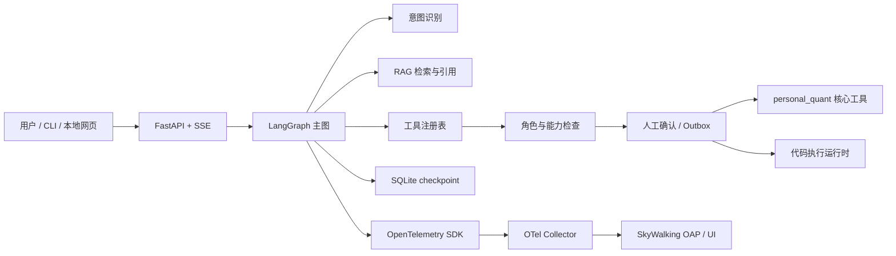

# 项目架构

项目分为量化分析核心和可选 Agent 扩展。核心包保持零第三方运行依赖；安装 `agent` extra 后，才启用 LangGraph、API、checkpoint 与 OpenTelemetry 相关能力。

## 系统边界

Collector、OAP 和 UI 的真实运行链路尚未端到端验收；图中表示部署目标与配置关系，不表示当前环境已运行。

## 模块职责

| 模块 | 职责 |
| --- | --- |
| `src/personal_quant/data_center` | 行情、外围、新闻与本地持仓输入的读取和校验 |
| `src/personal_quant/market_analysis` | 市场状态与板块分类分析 |
| `src/personal_quant/position_advisor` | 持仓风险条件分析 |
| `src/personal_quant/watchlist_engine` | 候选筛选 |
| `src/personal_quant/report_builder` | 本地 Markdown/CSV 报告、审计和推送预览 |
| `src/personal_quant/notifier` | 推送适配与状态检查；真实发送受显式开关控制 |
| `src/pq_agent/graph.py` | 意图分类、输入检查、检索、计划、预算、审批、执行和答复编排 |
| `src/pq_agent/tools` | 工具合同、能力标签、注册表及调用时权限检查 |
| `src/pq_agent/roles` | supervisor、analyst、operator 的能力视图 |
| `src/pq_agent/rag` | 语料准入、切块、BM25/向量/融合检索接口与引用校验 |
| `src/pq_agent/sandbox` | 本地约束层、Docker 与 gVisor runtime 接口和探测 |
| `src/pq_agent/approval.py` / `outbox.py` | 人工审批、幂等键和副作用状态跟踪 |
| `src/pq_agent/checkpoint.py` / `state.py` | 状态合同、脱敏和 SQLite checkpoint 守卫 |
| `src/pq_agent/observability` | OTel 属性净化、信号模型、本地快照、APM 状态与配置 |
| `src/pq_agent/server.py` | 本地 FastAPI、SSE、会话归属、鉴权和审批接口 |
| `src/pq_agent/demo` | 基于 fixture 的离线演示 |
| `agent_eval` | 意图、RAG、沙箱、golden task 和分层评测入口 |
| `deploy/apm` / `deploy/gvisor` | Collector/SkyWalking 与 Linux/gVisor 部署配置 |

## 一次 Agent 请求

1. 服务端将输入转换为版本化 Agent 状态。
2. 意图层先执行规则分类；未测通的模型通道保持显式不可用。
3. 主图检查输入、检索受控语料并校验引用，再生成允许的工具计划。
4. 工具注册表和当前角色再次检查能力；预算和参数合同在执行前校验。
5. 有副作用的工具先进入人工确认；只有批准后才进入执行和 outbox。
6. 结果连同引用、错误码和执行状态返回；checkpoint 支持状态恢复。
7. 遥测属性先经过白名单和脱敏，再进入本地记录或 OTLP 导出。

## 关键设计约束

- 核心包和 Agent 扩展分离，Agent 依赖位于 `agent` optional extra。
- 数据缺失、陈旧或合同不匹配时失败，不生成看似完整的报告。
- Agent 不计算权威业务数字，也不输出买卖结论。
- 工具注册表 deny-by-default；交易接口不对 Agent 开放。
- 写业务数据、外发消息和代码执行需要权限判断与人工确认。
- `LocalRuntime` 是约束层，不是安全隔离；Docker/gVisor 不可用时不得静默回落。
- APM、dense embedding、真实模型和云端隔离没有真实验收证据时必须标记未验证。

## 当前限制

- 最新公开状态见 [PUBLIC_STATUS.md](docs/agent/PUBLIC_STATUS.md)。
- 当前超时实现不能强制终止 Python 线程，超时后的迟到副作用仍是风险。
- SkyWalking Collector → OAP → UI 的三信号存储和查询链路尚未验证。
- 中文 dense embedding、真实 L2 模型通道、Docker/gVisor 真机和企业并发/长稳压测尚未完成。
