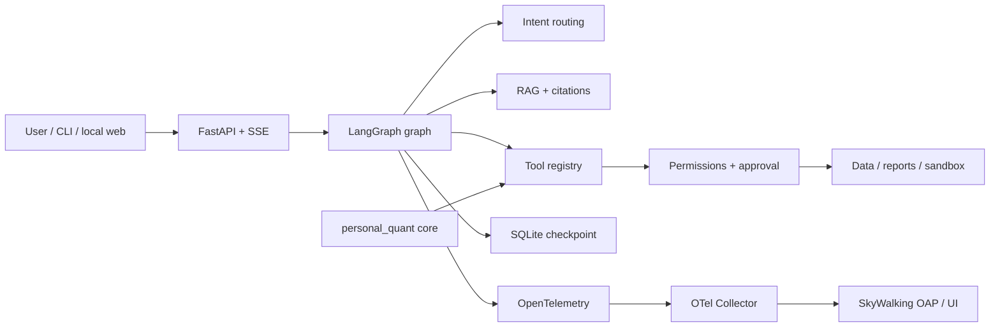

# Personal Quant Platform

[中文 README](README.md) · [Architecture](ARCHITECTURE.md) · [Agent docs](docs/agent/) · [Public status](docs/agent/PUBLIC_STATUS.md)


A **local-first quantitative research and analysis platform with a LangGraph-based Agent assistant**. It combines structured data processing and report generation with intent routing, RAG, access controls, human approval, constrained execution, OpenTelemetry instrumentation, and SkyWalking deployment configuration.

## Positioning

The platform consists of two integrated components:

1. **Quantitative analysis:** validate inputs, process data, analyze markets, and generate local reports.
2. **Agent assistant:** orchestrate registered tools with LangGraph to retrieve information and explain structured results; actions with side effects go through human approval.

## Features

| Area | Current implementation |
| --- | --- |
| Agent orchestration | LangGraph graph, versioned `AgentState`, SQLite checkpoint, pause/resume |
| Intent routing | L1 rule routing; L2 model channel and evaluation entry point are present but no live model is configured |
| RAG | Corpus allowlist, chunking, freshness, BM25 / vector / hybrid interfaces, citation validation; BM25 is the only validated retrieval mode |
| Human approval | File writes, notifications, and code execution create an approval before entering the outbox |
| Sandboxing | Windows `LocalRuntime` constraint layer, Docker configuration, gVisor Linux deployment scripts; LocalRuntime is not isolation |
| Roles | supervisor / analyst / operator, deny-by-default registry, repeated capability checks |
| Observability | OpenTelemetry allowlisted attributes, redaction, local event log, traces / metrics / logs model, Collector + SkyWalking configuration |
| API and demo | 127.0.0.1 FastAPI + SSE + token/Origin/Host checks; nine-step offline demo |
| Evaluation | Replay fixtures, deterministic judges, intent/RAG/sandbox/golden-task evaluation |
| Dependency boundary | Core `personal_quant` stays dependency-free; Agent dependencies live in the `agent` optional extra |

## Architecture



The core analysis layer and the Agent layer are separate. The Agent can only call registered capabilities; trading modules are not visible to it, and real external delivery requires an explicit approval path.

## Quick start

### Requirements

- Python 3.11+
- [uv](https://docs.astral.sh/uv/)
- Docker Desktop or Linux Docker only when deploying APM or the Docker sandbox

### Install

```bash
uv sync --extra agent --locked
```

The core package can be imported without Agent dependencies:

```bash
uv run --no-sync python -c "import personal_quant; print('core-ok')"
```

### Check and run the offline demo

Rebuild the RAG index after changing source documents:

```bash
uv run --no-sync --extra agent python agent_eval/rebuild_rag_index.py
uv run --no-sync --extra agent python -m pq_agent demo --status
uv run --no-sync --extra agent python -m pq_agent demo --reset
uv run --no-sync --extra agent python -m pq_agent demo --json
```

The demo uses local fixtures and does not call market, Feishu, or trading endpoints. If a checkout reports `RAG_INDEX_STALE`, the freshness guard is working; rebuild the index and rerun the demo.

### Start the local panel

```bash
uv run --no-sync --extra agent python -m pq_agent.server --port 8137 --role analyst
```

The server listens on localhost only. `supervisor` is the least-privileged default role and cannot directly call analysis tools; use `analyst` for a read-only demo.

### Run tests and evaluation

```bash
uv run --no-sync --extra agent python -m unittest discover -s tests/agent -t .
uv run --no-sync --extra agent python agent_eval/run_all.py --layers l0,l1,l2,l3 --write
```

Keep `UNKNOWN`, `NOT_MEASURED`, and `BLOCKED` results. Do not replace real platform evidence with mocks or local snapshots.

## APM: OpenTelemetry + SkyWalking

The application speaks OpenTelemetry; the deployment layer provides an OTel Collector, SkyWalking OAP, and SkyWalking UI:

```bash
uv run --no-sync --extra agent python -m pq_agent status --json
# Replace the placeholder image digests with registry-verified digests first.
docker compose -f deploy/apm/docker-compose.yml up -d
uv run --no-sync --extra agent python -m pq_agent status --json --strict
```

The repository contains the three-signal model, redaction, and Collector/SkyWalking configuration. The current machine has no Docker, so the full **application → Collector → SkyWalking OAP → UI** path has not been proven for traces, metrics, and logs. The Compose image digests are placeholders; do not start the stack until they have been replaced with registry-verified digests.

See [the APM deployment guide](docs/agent/APM_DEPLOYMENT.md) and [the telemetry contract](docs/agent/TELEMETRY_SCHEMA.md).

## Demo flow

Use [DEMO_RUNBOOK](docs/agent/DEMO_RUNBOOK.md) to verify:

1. Environment checks and configuration fingerprints.
2. Replay Q&A, BM25 retrieval, and citations.
3. Missing-input failure without fabricated conclusions.
4. Rejection of file writes and external delivery.
5. Two-stage approval and outbox behavior.
6. The difference between LocalRuntime, Docker, and gVisor boundaries.
7. Local traces, metrics, logs, and alert models with an explicit APM degraded state.
8. Checkpoint recovery after a process restart.
9. Code-level role denial.

The flow covers the core capabilities, boundary conditions, and environment checks that remain incomplete.

## Verification status

| Scope | Result |
| --- | --- |
| Public-export full test suite | **PASS**: 966 tests, 1 skipped |
| Offline demo | **PASS**: 9/9, zero outbound attempts |
| Local four-layer evaluation | **PASS / UNKNOWN**: L0–L2 passed; L3 is `unknown` without the platform environment |
| RAG | BM25 has local evaluation; Chinese dense embeddings are unverified |
| Intent | Offline rule data exists; the real L2 model channel is unverified |
| Sandbox | Constraint and argv contracts are tested; Docker/gVisor isolation is unverified |
| APM | OTel code and SkyWalking assets exist; Collector → OAP → UI is unverified |
| Load and endurance | Enterprise concurrency and long-run testing is incomplete |
| Timeout semantics | The current thread timeout drops late results but cannot forcibly terminate a thread; side-effect tools must not be treated as fully safe |

See [PUBLIC_STATUS.md](docs/agent/PUBLIC_STATUS.md) for the public verification snapshot and known risks.

## Repository layout

```text
src/personal_quant/     Existing quantitative data, analysis, reports, and notifications
src/pq_agent/           LangGraph Agent, RAG, sandbox, roles, APM, API, and demo
agent_eval/             Intent, RAG, sandbox, and golden-task evaluation entry points
deploy/apm/             OTel Collector + SkyWalking Compose configuration
deploy/gvisor/          Linux/gVisor deployment and probing scripts
tests/                  Core and Agent tests
docs/                   Product, data, architecture, and Agent contracts
```

## Boundaries

- Missing, stale, or incomplete critical data fails closed.
- The Agent cannot invent key numbers or generate buy/sell conclusions.
- Business writes, external delivery, and code execution require capability checks and human approval.
- `LocalRuntime` provides constraints, static checks, and output limits; it is not kernel-level isolation.
- No open-source license has been selected yet; do not treat the repository as a redistributable software package until that is decided.

## Documentation

- [Architecture](ARCHITECTURE.md)
- [LangGraph graph contract](docs/agent/GRAPH_CONTRACT.md)
- [RAG data policy](docs/agent/RAG_DATA_POLICY.md)
- [Sandbox contract](docs/agent/SANDBOX_CONTRACT.md)
- [gVisor deployment](docs/agent/GVISOR_DEPLOYMENT.md)
- [Four-layer evaluation](docs/agent/EVAL.md)
- [Demo runbook](docs/agent/DEMO_RUNBOOK.md)

## Contributing

Before submitting a change, run at least:

```bash
uv run --no-sync --extra agent python -m compileall -q src tests
uv run --no-sync --extra agent python -m unittest discover -s tests/agent -t .
```

New capabilities should include their boundaries, failure paths, reproducible tests, and documentation. Unverified environment capabilities must remain explicitly unverified.

## License

No open-source license has been selected yet. Unless separately authorized in writing, the repository grants no license to redistribute, modify, or use the contents commercially.
