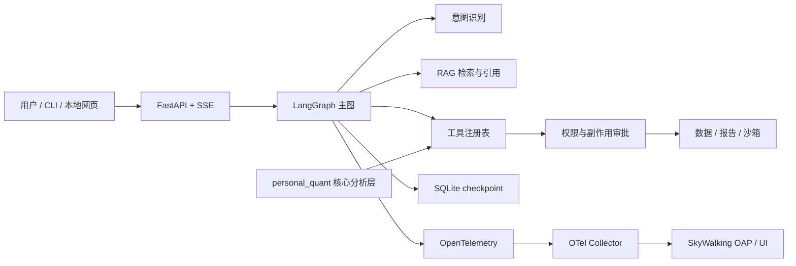

# Personal Quant Platform

[English README](README.en.md) · [架构说明](ARCHITECTURE.md) · [Agent 文档](docs/agent/) · [公开状态](docs/agent/PUBLIC_STATUS.md)


一个**本地优先的个人量化分析平台与 Agent 工程实验室**。项目的重点不是让模型替人下单，而是把企业 Agent 开发中常见的工程问题放进一个可以运行、评测、解释和复盘的代码库里：LangGraph 编排、意图识别、RAG、人工确认、沙箱、断点恢复、权限隔离、OpenTelemetry 与 SkyWalking APM 配置，以及可复跑的离线演示。

> **当前状态（2026-10-20，Asia/Shanghai）**：公开副本复跑 966 项测试（1 项跳过）、离线演示 9/9 且外呼 0；四层评测 L0–L2 通过，L3 因缺少 Docker/SkyWalking 环境为 `unknown`。项目适合本地演示和面试讲解，不能宣称生产可用、真实交易可用或 SkyWalking 端到端已验收。

## 项目定位

这个项目同时服务两个目标：

1. 先生成可信的本地量化报告，再考虑推送、模拟交易和自动交易。
2. 用一个小型但完整的 Agent 系统练习真实企业里的边界：数据缺失时失败，工具有副作用时暂停，模型只解释证据，不生成买卖结论。

项目明确不接券商、不自动下单，也不把真实持仓、行情、飞书回执或本机运行记录提交到公开仓库。

## 核心能力

| 能力 | 当前实现 |
| --- | --- |
| Agent 编排 | LangGraph 主图、版本化 `AgentState`、SQLite checkpoint、暂停与恢复 |
| 意图识别 | L1 规则路由；L2 模型通道保留接口和评测入口，当前未配置真实模型 |
| RAG | 语料白名单、切块、freshness、BM25 / vector / hybrid 接口、四要素引用校验；当前只验证 BM25 |
| 人工确认 | 写盘、外发、代码执行等副作用动作先生成审批，再进入 outbox，拒绝或超时按拒绝处理 |
| 沙箱 | Windows `LocalRuntime` 约束层、Docker 配置、gVisor Linux 部署脚本；LocalRuntime 不是安全隔离 |
| 权限 | supervisor / analyst / operator 三角色，工具注册表默认拒绝，调用前再次检查能力 |
| 可观测性 | OpenTelemetry 属性白名单、脱敏、本地事件日志、traces / metrics / logs 模型、Collector + SkyWalking 配置 |
| API 与演示 | 127.0.0.1 FastAPI + SSE + token/Origin/Host 校验；9 步离线演示脚本 |
| 可评测性 | replay fixture、确定性判题、意图/RAG/沙箱/golden task 通道评测 |
| 依赖边界 | 核心 `personal_quant` 保持零第三方依赖；Agent 依赖集中在 `agent` optional extra |

## 架构



核心分析层与 Agent 层分开。Agent 只能调用已经登记的能力，交易相关模块对 Agent 不可见；真实外发必须显式进入确认流程。

## 快速开始

### 环境

- Python 3.11+
- [uv](https://docs.astral.sh/uv/)
- Docker Desktop 或 Linux Docker（只有部署 APM、Docker 沙箱时需要）

### 安装

```bash
uv sync --extra agent --locked
```

核心包不需要 Agent 依赖：

```bash
uv run --no-sync python -c "import personal_quant; print('core-ok')"
```

### 检查和离线演示

RAG 源文档变化后，先重建索引：

```bash
uv run --no-sync --extra agent python agent_eval/rebuild_rag_index.py
uv run --no-sync --extra agent python -m pq_agent demo --status
uv run --no-sync --extra agent python -m pq_agent demo --reset
uv run --no-sync --extra agent python -m pq_agent demo --json
```

演示使用本地 fixture，默认不访问行情、飞书或交易接口。当前检出如果提示 `RAG_INDEX_STALE`，这是索引 freshness 保护在工作，重建索引后再运行。

### 启动本地面板

```bash
uv run --no-sync --extra agent python -m pq_agent.server --port 8137 --role analyst
```

服务只监听本机地址。`supervisor` 是最小权限的默认角色，不直接调用分析工具；只读演示使用 `analyst`。

### 运行测试和评测

```bash
uv run --no-sync --extra agent python -m unittest discover -s tests/agent -t .
uv run --no-sync --extra agent python agent_eval/run_all.py --layers l0,l1,l2,l3 --write
```

评测结果中的 `UNKNOWN`、`NOT_MEASURED` 和 `BLOCKED` 必须保留，不能用 mock 或本地快照冒充真实平台能力。

## APM：OpenTelemetry + SkyWalking

应用侧只依赖 OpenTelemetry 协议，部署侧提供 OTel Collector、SkyWalking OAP 和 SkyWalking UI：

```bash
uv run --no-sync --extra agent python -m pq_agent status --json
# Replace the placeholder image digests with registry-verified digests first.
docker compose -f deploy/apm/docker-compose.yml up -d
uv run --no-sync --extra agent python -m pq_agent status --json --strict
```

当前仓库包含三信号模型、脱敏和 Collector/SkyWalking 配置，但本机没有 Docker，尚未证明真实 Agent 请求能完成 **应用 → Collector → SkyWalking OAP → UI** 的 traces、metrics、logs 入库与查询。Compose 文件中的镜像 digest 是占位值，替换成注册表核对过的真实 digest 前不能启动栈，也不能视为供应链验收通过。

详细说明见 [APM 部署手册](docs/agent/APM_DEPLOYMENT.md) 和 [遥测合同](docs/agent/TELEMETRY_SCHEMA.md)。

## 面试演示路线

建议按 [DEMO_RUNBOOK](docs/agent/DEMO_RUNBOOK.md) 演示：

1. 环境体检与配置指纹。
2. replay 问答、BM25 检索和引用。
3. 缺数据时返回失败，不补造结论。
4. 拒绝写盘/外发，证明没有副作用。
5. 双阶段人工确认与 outbox。
6. 展示 LocalRuntime、Docker、gVisor 的边界差异。
7. 展示本地 trace、指标、日志和告警模型，并明确 APM 降级状态。
8. 进程重启后的 checkpoint 恢复。
9. 角色越权被代码层拒绝。

这套演示的价值是能同时讲清楚“能力怎么做”和“还没有验证什么”。

## 验证状态

| 范围 | 结果 |
| --- | --- |
| 公开副本全量测试 | **PASS**：966 项，1 项跳过 |
| 离线演示 | **PASS**：9/9，外呼 0 |
| 四层本地评测 | **PASS / UNKNOWN**：L0–L2 通过，L3 因无平台环境为 `unknown` |
| RAG | BM25 有本地评测；中文 dense embedding 未验证 |
| 意图识别 | 规则层有离线数据集；真实 L2 模型通道未验证 |
| 沙箱 | 约束与 argv 合同有测试；Docker/gVisor 真机隔离未验证 |
| APM | OTel 代码和 SkyWalking 配置存在；Collector → OAP → UI 未验证 |
| 并发与长稳 | 未完成企业环境压测 |
| 超时语义 | 当前线程超时只能丢弃迟到结果，不能强制终止线程；副作用工具不应被当作已完全安全 |

公开版的详细状态和风险记录见 [PUBLIC_STATUS.md](docs/agent/PUBLIC_STATUS.md)。

## 项目结构

```text
src/personal_quant/     原有量化数据、分析、报告和通知模块
src/pq_agent/           LangGraph Agent、RAG、沙箱、权限、APM、API、演示
agent_eval/             意图、RAG、沙箱和 golden task 评测入口
deploy/apm/             OTel Collector + SkyWalking Compose 配置
deploy/gvisor/          Linux/gVisor 部署和探测脚本
tests/                  核心层与 Agent 层测试
docs/                   产品、数据、架构和 Agent 合同文档
```

## 重要边界

- 关键数据缺失、过期或不完整时直接失败。
- Agent 不能自己计算关键数字，也不能生成买卖结论。
- 写业务数据、外发消息和代码执行必须经过权限检查与人工确认。
- `LocalRuntime` 只提供约束、静态检查和输出限制，不等于内核级隔离。
- 真实持仓、报告、webhook、运行截图和验收证据不进入公开仓库。
- 当前仓库没有选择开源许可证；在许可证确定前，请不要把它当作可再发布的软件包。

## 文档入口

- [架构说明](ARCHITECTURE.md)
- [LangGraph 主图合同](docs/agent/GRAPH_CONTRACT.md)
- [RAG 数据策略](docs/agent/RAG_DATA_POLICY.md)
- [沙箱合同](docs/agent/SANDBOX_CONTRACT.md)
- [gVisor 部署](docs/agent/GVISOR_DEPLOYMENT.md)
- [四层评测](docs/agent/EVAL.md)
- [面试演示手册](docs/agent/DEMO_RUNBOOK.md)

## 贡献

提交改动前至少运行：

```bash
uv run --no-sync --extra agent python -m compileall -q src tests
uv run --no-sync --extra agent python -m unittest discover -s tests/agent -t .
```

新增能力时，请同时补充边界、失败路径、可复跑测试和文档；不要把未验证的环境能力写成通过。

## License

当前尚未选择开源许可证。除非另有书面授权，仓库内容不授予再分发、修改或商业使用许可。
